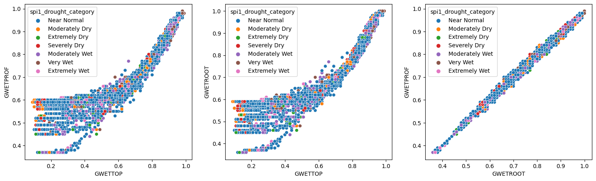

# Drought Severity Prediction for Maharashtra, India

Classifies monthly drought severity for all 36 districts of Maharashtra using NASA climate data and the Standardized Precipitation Index (SPI), and explores how El Niño / La Niña (ENSO) relates to dry spells. MSc practicum project, Dublin City University.

## Business problem

Most farming in Maharashtra is rain-fed, so a dry month hits crops, water supply and rural incomes hard. If district officials can see a drought coming a few months early, they can plan water tankers, crop advice and relief funds sooner. The goal: predict a district's drought category for the next 1, 3 and 6 months from climate signals that are freely available.

## Data

| Source | What | Coverage |
|---|---|---|
| [NASA POWER API](https://power.larc.nasa.gov/) | Monthly precipitation, temperature, humidity, surface pressure, wind, soil wetness (surface, root zone, profile) | 36 districts, 2001–2021 (9,072 district-months) |
| NASA POWER (district files) | Long-run climate history for Latur and Osmanabad | 1981–2021 |
| ENSO indices | Oceanic Niño Index (ONI), Southern Oscillation Index (SOI), Niño sea-surface temperatures | 1951–2021 |

Raw data is not included in this repo. Notebook `01` downloads it from the NASA POWER API.

### Target: SPI drought category

SPI measures how unusual a month's rainfall is compared with that district's own history. It was calculated for 1-, 3- and 6-month windows with the `standard-precip` package (gamma distribution), then grouped into 7 classes:

| SPI | Category | Share of district-months (SPI-1) |
|---|---|---|
| ≥ 2.0 | Extremely Wet | 1.6% |
| 1.5 to 1.99 | Very Wet | 4.9% |
| 1.0 to 1.49 | Moderately Wet | 9.4% |
| −0.99 to 0.99 | Near Normal | **73.9%** |
| −1.0 to −1.49 | Moderately Dry | 5.5% |
| −1.5 to −1.99 | Severely Dry | 2.5% |
| ≤ −2.0 | Extremely Dry | 2.3% |

## Approach

| Notebook | Step |
|---|---|
| `00_spi_and_enso_exploration` | First look at ENSO indices and a single-location SPI |
| `01_collect_district_climate_data` | Pull monthly climate data for all 36 districts from the NASA POWER API |
| `02_calculate_spi` | Calculate SPI-1, SPI-3 and SPI-6 per district and assign drought categories |
| `03_eda_latur_osmanabad` | 40-year trends for two drought-prone districts in Marathwada |
| `04_eda_correlation` | Correlation between climate variables and SPI |
| `05_eda_and_modeling` | Scaling, feature selection (correlation, RFE with random forest), PCA, then Random Forest, Logistic Regression and a neural network (MLP), each tuned with grid search |



## Results

**Exploration:** soil wetness (surface, root zone and profile) separates dry and wet months most clearly, and the three soil layers are almost perfectly correlated, so only one is needed.

**Models (SPI-1, test set of 1,815 district-months):**

| Model | Accuracy | Weighted F1 |
|---|---|---|
| Baseline: always predict "Near Normal" | **0.74** | — |
| Random Forest (default) | 0.54 | 0.54 |
| Random Forest (tuned) | 0.35 | 0.39 |
| Logistic Regression (tuned) | 0.35 | 0.42 |
| Neural network (MLP) | 0.18 | 0.26 |

**Known issue.** The models are trained on PCA-transformed features (`X_train1_PCA`) but predict on the untransformed test features (`X_test1`). Train and test features are in different spaces, which is why every model scores below the simple baseline. The fix is one line per model:

```python
y_pred1 = model.predict(X_test1_PCA)   # instead of model.predict(X_test1)
```

After fixing that, the next step is handling class imbalance (three out of four months are "Near Normal") with class weights or SMOTE, and judging models on **macro F1 and recall for the dry classes**, because missing a drought costs far more than a false alarm.

## Tech stack

Python · pandas · NumPy · scikit-learn · standard-precip · Plotly · seaborn · NASA POWER API · Google Colab

## How to run

```bash
git clone https://github.com/Omkyao1998/Drought_Prediction_India.git
cd Drought_Prediction_India
pip install -r requirements.txt
```

Run the notebooks in number order. They were written in Google Colab, so change the Google Drive paths at the top of each notebook to your own folder.

## What I would improve next

- Apply the PCA fix above and re-run all models
- Use a time-based split (train on 2001–2017, test on 2018–2021) so the model never sees the future
- Add lagged features (last 1–3 months of rainfall and soil wetness) and ENSO indices as inputs
- Map predicted drought risk by district

## Author

**Omkar Gokhale** — Data Engineer & BI Analyst · [GitHub](https://github.com/Omkyao1998)
